


  

 


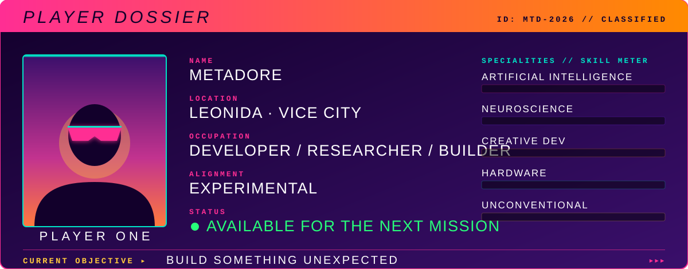

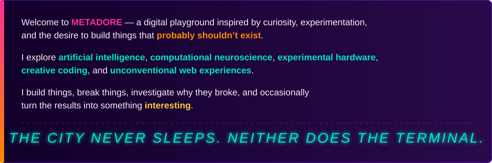

 



 


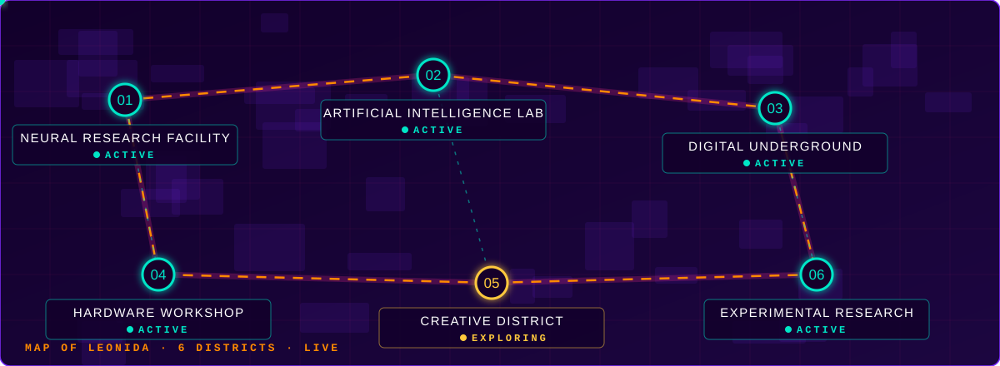

 


<table>
<tr>
<td width="50%" valign="top">

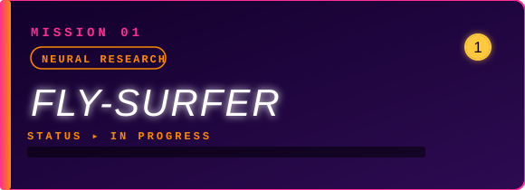

**Teaching a fruit fly brain to play Subway Surfers through connectome-based neural simulation.**

A computational neuroscience experiment combining connectomics, spiking neural networks, visual perception, motor decisions, and reward-based learning.

- 🧬 FlyWire connectome research
- ⚡ Leaky Integrate-and-Fire neural simulation
- 👁️ Visual perception pipeline
- 📡 Neural information theory
- 🎯 Experimental reward-learning mechanisms

</td>
<td width="50%" valign="top">

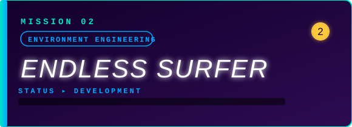

**An independent endless-runner game environment.**

Designed as a controlled playground for experimentation and future AI integration.

</td>
</tr>
<tr>
<td width="50%" valign="top">

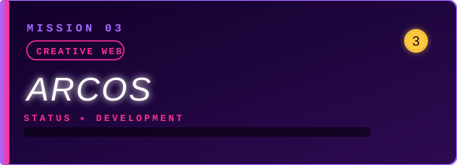

**An experimental web experience.**

Exploring modern frontend development, animation, and interactive visual design.

</td>
<td width="50%" valign="top">

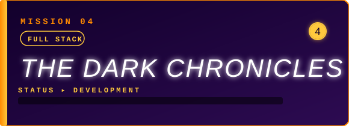

**An experimental full-stack web project.**

Authentication, backend architecture, databases, and modern application development.

</td>
</tr>
</table>

 


  

 


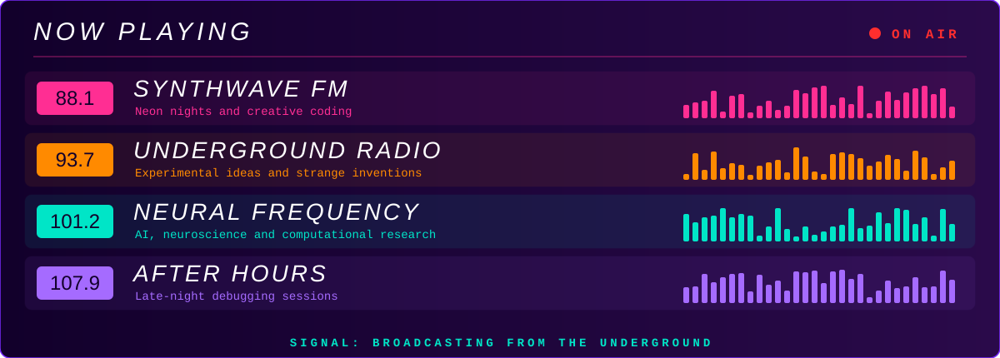

 


 

 


<b>EVERY COMMIT LEAVES A FOOTPRINT IN THE CITY.</b>

 


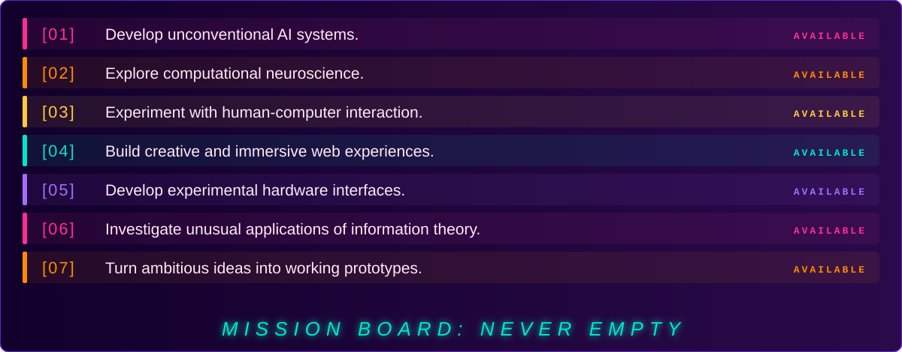

 


🌴 &nbsp; 🌆 &nbsp; 💻 &nbsp; 🏎️ &nbsp; 🌴

